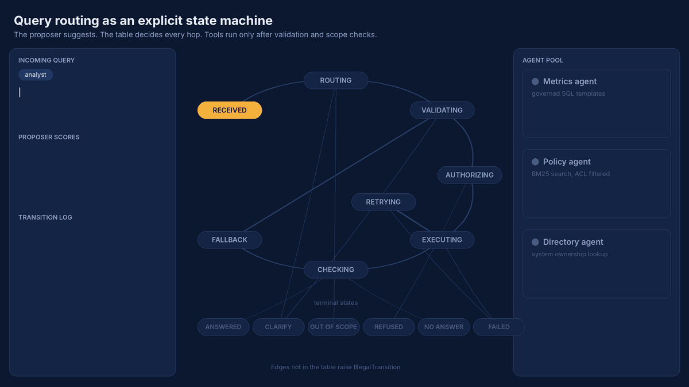

# query-router-fsm

A deterministic state machine that routes enterprise search questions to the right specialist tool (governed metrics, policy documents, ownership directory), validates every tool call before it runs, and can say "clarify", "refused", "out of scope" or "no answer" instead of guessing. Ships with an evaluation harness that scores it against fan-out and search-only baselines on labeled queries.

Runtime is the Python standard library. No model, API key or cloud service is needed to run the examples.

## The problem

Enterprise search assistants usually start in one of two shapes.

1. **Search for everything.** Every question goes to a document index. Questions like "refund rate in UAE for Q2" retrieve the refund *policy*, and the model invents or approximates a number from text that never contained it.
2. **Fan out to every tool.** Every question calls every backend and a model synthesises. This finds more evidence, but it collapses very different situations into one: the user lacks permission, the question is ambiguous, the request is outside the system, or nothing was found. All of them come back as "no answer", or worse, as a confident answer built from whatever was retrieved.

Adding an LLM with tool calling helps pick the tool, but on its own it does not decide what happens when arguments are invalid, a tool times out, a result is too weak to answer from, or the caller is not allowed to see a field. Those decisions end up scattered through prompt text and glue code, and nobody can list the paths a request can take.

## How this repo solves it

| Problem | Mechanism in this repo |
|---|---|
| Wrong tool for the question | A proposer scores intents (metrics, policy, directory) and routes only when confidence and margin clear configured thresholds. Otherwise it returns `CLARIFY`. |
| Numbers answered from documents | Numeric questions go to `metrics_query`, which runs allow-listed SQL templates with bound parameters. There is no fallback from metrics to search. |
| Model invents arguments or tools | Every proposed call is validated against the tool's JSON Schema contract plus semantic checks (period order, data range) before execution. Unknown tool names are rejected. |
| Permission leaks through fallbacks | `AUTHORIZING` checks role scopes per call, including field-level scopes (`directory:restricted`). A refusal is terminal. Fallback only happens after an *insufficient* result, never after a refusal. |
| Weak results presented as answers | Each tool has a sufficiency check (rows returned, BM25 score and query-term coverage, entity resolved). Insufficient results follow a configured fallback chain or end in `NO_ANSWER`. |
| Unbounded or hidden control flow | Every hop must be an edge in `TRANSITIONS`. Anything else raises `IllegalTransition`. Tool-call and transition budgets are shared across sub-questions. |
| Compound questions | Up to `max_subtasks` sub-questions are split and each runs its own sub-machine. Mixed results return `PARTIAL`. |
| No way to know if routing is good | `evaluate.py` scores outcome accuracy, a confusion matrix, cost, latency and context precision against labeled queries, side by side with two baselines. |

### State machine

```text
RECEIVED -> ROUTING
ROUTING -> VALIDATING | CLARIFY | OUT_OF_SCOPE
VALIDATING -> AUTHORIZING | CLARIFY
AUTHORIZING -> EXECUTING | REFUSED
EXECUTING -> CHECKING | RETRYING | FAILED
RETRYING -> EXECUTING
CHECKING -> ANSWERED | FALLBACK | NO_ANSWER
FALLBACK -> VALIDATING
any non-terminal -> FAILED   (budget exhausted, tool or proposer error)
```

Terminal states: `ANSWERED`, `CLARIFY`, `OUT_OF_SCOPE`, `REFUSED`, `NO_ANSWER`, `FAILED`. A request with several sub-questions also reports `PARTIAL` when some, but not all, sub-questions are answered.

## Results on the bundled synthetic set

73 labeled synthetic queries across metrics, policy, directory, compound, ambiguous, unauthorised, unanswerable and out-of-scope cases (`ARTIFACT/examples/eval_queries.jsonl`). Reproduce with the eval command below. Full output is in `ARTIFACT/examples/expected_eval_report.json`.

| metric | router | vector_only | fan_out |
|---|---|---|---|
| outcome accuracy | 0.918 | 0.274 | 0.699 |
| accuracy on answerable queries | 0.911 | 0.321 | 0.875 |
| accuracy on non-answerable queries | 0.941 | 0.118 | 0.118 |
| answered when it should not have | 1 | 3 | 4 |
| tool calls per query | 0.9 | 1.0 | 2.3 |
| USD per 1k queries (illustrative prices) | 0.924 | 0.252 | 0.570 |
| USD per 1k queries without an LLM routing call | 0.468 | 0.252 | 0.570 |
| p50 / p95 latency ms (modelled) | 1497 / 1726 | 180 / 1149 | 1147 / 1360 |
| context precision | 0.80 | 0.41 | 0.71 |

How to read this honestly:

- **The heuristic proposer was written alongside this query set.** Treat 0.918 as an upper bound for the heuristic, not a forecast for your traffic. The point of the harness is to run it on your own labeled queries.
- **Baselines are scored generously.** Fan-out is assumed to have a perfect synthesiser that always finds the right evidence in what it retrieved, and both baselines get the same ACLs and sufficiency checks. They still cannot clarify or refuse, because their design has no state for it.
- **The router is not free.** When routing is priced as an LLM call, it costs more per query than fan-out here and adds a sequential hop of latency. The synthetic documents are short, so fan-out's synthesis context stays small; with production-sized chunks the token gap widens. Measure it on your own corpus.
- **Known router misses** in this set: a trend question whose metric was not extracted (safe `CLARIFY`), "across all regions" not mapped to a grouping, a lexicon gap sending a credential-rotation question out of scope, a retrieval coverage miss, a pronoun ("its cost center") in a compound question, and one false answer where a generic leave policy matched a parental-leave question.

## Quick start

Requires Python 3.10 or newer (tested on 3.13).

```bash
cd ARTIFACT
python -m pip install -r requirements.txt     # only pytest; runtime is stdlib
python -m pytest -q                            # 77 tests

# route one question and print the full trace
PYTHONPATH=src python -m query_router ask "What is the refund rate in UAE for Q2 and who owns the billing-api?" --role analyst

# fallback path: directory miss, then policy search
PYTHONPATH=src python -m query_router ask "Who owns the legacy fax gateway?" --role support

# refusal: restricted field, no tool is called, no fallback
PYTHONPATH=src python -m query_router ask "What is the personal phone of the payments gateway owner?" --role analyst

# evaluation against both baselines
PYTHONPATH=src python -m query_router eval --queries examples/eval_queries.jsonl --out report.json --markdown report.md
```

`ask` exits with 0 for `ANSWERED` or `PARTIAL` and 2 otherwise, so it can be scripted. Example traces are in `ARTIFACT/examples/sample_trace_*.json`.

## Configuration

Defaults live in `ARTIFACT/src/query_router/default_config.json`. Override any subset with a JSON file passed via `--config` or `ROUTER_CONFIG`. Overrides are deep-merged and validated (thresholds in range, budgets positive, fallback graph acyclic).

| Key | Purpose |
|---|---|
| `routing.min_confidence`, `routing.min_margin` | Below either, the proposer returns `CLARIFY` instead of guessing |
| `routing.max_subtasks` | Maximum sub-questions per request; more returns `CLARIFY` |
| `budgets.max_tool_calls`, `budgets.max_transitions` | Hard caps shared across all sub-questions in a request |
| `budgets.max_retries` | Retries for `TransientToolError` with exponential backoff (0.2 s base, 2 s cap) |
| `fallbacks` | Route to try when a result is insufficient, for example `directory -> policy` |
| `policy_search.min_score`, `min_term_coverage` | Sufficiency thresholds for document answers |
| `roles` | Scopes per role. `directory:restricted` gates restricted fields |
| `cost_model` | Illustrative token prices, tool costs and latencies used only by the evaluator |

| Environment variable | Purpose |
|---|---|
| `ROUTER_CONFIG` | Path to a JSON override |
| `ROUTER_DATA_DIR` | Directory with `orders.csv`, `docs.jsonl`, `directory.json` |
| `ROUTER_LOG_LEVEL` | `WARNING` by default. `DEBUG` emits one JSON line per transition |
| `ROUTER_LOG_QUERY_TEXT` | Set to `1` to log raw query text. Off by default |

## Using an LLM as the proposer

`llm_adapter.OpenAICompatibleProposer` sends the tool contracts plus two control tools (`ask_clarification`, `out_of_scope`) to an OpenAI-compatible Chat Completions endpoint and converts the returned `tool_calls` into sub-tasks. Parallel tool calls become sub-questions. Everything the model returns still goes through validation, authorization and the transition table, so a malformed argument string, an invented tool name or a restricted field ends in `CLARIFY` or `REFUSED`, never in execution.

```bash
export ROUTER_LLM_URL="https://<your-endpoint>/v1/chat/completions"
export ROUTER_LLM_MODEL="<model-or-deployment>"
export ROUTER_LLM_API_KEY="<secret>"          # read at call time, never logged
export ROUTER_LLM_AUTH_HEADER="api-key"       # only for endpoints that use an api-key header
PYTHONPATH=src python -m query_router --proposer llm ask "Who owns the CRM?"
```

The request uses `tool_choice: "required"` and `temperature: 0`. Some compatible servers do not accept these; adjust `build_request` if yours rejects them. The adapter's request and response handling is covered by tests through an injected transport. It has not been run against a live endpoint in this repo, so validate it against yours first. Provider-side strict schema modes are useful but depend on the model and request configuration, which is why arguments are validated locally regardless.

## Adapting it to your platform

1. **Replace the tools.** Implement `spec`, `check_args`, `required_scopes` and `run` (see `tools.py`). Typical swaps: `MetricsTool` onto a Databricks SQL warehouse or semantic layer with the same allow-listed templates, `PolicySearchTool` onto your vector or hybrid index with ACL filters applied before ranking, `DirectoryTool` onto your service catalog.
2. **Keep sufficiency checks tool-specific.** A row count is not a retrieval score. Decide per tool what "good enough to answer from" means and make it testable.
3. **Label 100 to 300 real questions** in the `eval_queries.jsonl` format, including ambiguous, unauthorised and out-of-scope ones. Without those negative cases, every router looks good.
4. **Run the harness before and after every routing change** (lexicon, prompt, model, thresholds) and compare the confusion matrix, not just accuracy.
5. **Price your real costs** in `cost_model` from billing data and measured latencies.

## Cost and accuracy model

Per query, as implemented in `evaluate.CostModel`:

```text
usd     = routing_call + sum(tool_usd) + synthesis
routing_call = (router_in * price_in + router_out * price_out)        # only when an LLM routes
synthesis    = ((synth_base_in + evidence_tokens) * price_in + synth_out * price_out)   # only for ANSWERED/PARTIAL
latency = routing_ms + (sum(tool_ms) if sequential else max(tool_ms)) + synth_ms + synth_ms_per_1k * input_tokens / 1000
evidence_tokens = len(json(result items)) / 4
```

`CLARIFY` adds a short generated question. `REFUSED`, `NO_ANSWER` and `OUT_OF_SCOPE` are templated and add no model cost. All prices and latencies in the default config are illustrative.

Accuracy metrics: outcome accuracy (status matches gold, and for answers every gold part is supported by returned evidence), split into answerable and non-answerable subsets, a confusion matrix of gold label versus predicted label, and context precision (share of returned evidence items that support a gold part).

## Security and privacy

- Metrics use allow-listed templates. Identifiers come from code, values are bound parameters, and the argument contract rejects anything outside the enums.
- Document ACLs are applied before ranking, so restricted documents do not influence scores and their existence is not revealed (`NO_ANSWER`, not `REFUSED`).
- Restricted directory fields need an extra scope and are refused explicitly. There is no fallback after a refusal.
- Logs carry a query hash, state names, reasons and argument hashes. Query text and result values are not logged unless `ROUTER_LOG_QUERY_TEXT=1`.
- Unknown roles, proposer exceptions and tool errors fail closed (`FAILED`).
- Sample data is synthetic. Names, emails and phone numbers are fictional placeholders.

## Assumptions and limits

- The heuristic proposer is lexical. It handles the bundled vocabulary and simple compound questions; it does not resolve pronouns across sub-questions or understand paraphrases outside its cue lists. Use the LLM proposer or your own classifier for broad traffic, and keep the state machine.
- Sufficiency checks are simple. Term coverage can accept a near-miss document (the parental-leave case). Production search should add reranking or a calibrated relevance threshold.
- Fallback arguments are rebuilt from the sub-question text. Only `policy` has a fallback argument builder by default.
- Budgets here are simple caps. They stop runaway requests; they are not a latency SLO.
- Retries use in-process sleeps. In an async service, move backoff to your scheduler.
- The cost and latency model is a calculator, not a benchmark.

## Rollback and recovery

- The router holds no state between requests, so rolling back is redeploying the previous version and config.
- Ship routing changes behind a config flag: run the new proposer in shadow, log its `RouteResult` next to the live one, compare with the harness on the same labels, then switch.
- Raising `routing.min_margin` or `routing.min_confidence` is the fastest safe lever when misroutes appear: more questions become `CLARIFY` instead of wrong answers.
- If a backend degrades, set its retries to 0 and remove it from `fallbacks` so requests fail fast with a clear status instead of piling up.

## Production adoption checklist

- [ ] Tools wrapped with real backends, each with a schema contract, scopes and a sufficiency check
- [ ] Roles mapped from your identity provider claims, not from request input
- [ ] Labeled query set covering negative cases, stored and versioned with the router config
- [ ] Harness run in CI with a minimum outcome accuracy and a cap on answers-when-it-should-not
- [ ] Transition logs shipped to your tracing stack with request IDs
- [ ] Shadow comparison done before switching proposers or thresholds
- [ ] Cost model updated with real prices and measured latencies
- [ ] Alert on rising `CLARIFY`, `NO_ANSWER` and `FAILED` rates per route

## Repo layout

```text
.
├── README.md
├── assets/architecture.gif
└── ARTIFACT/
    ├── requirements.txt
    ├── src/query_router/
    │   ├── fsm.py               state machine, transition table, budgets, retries, fallbacks
    │   ├── proposers.py         heuristic proposer, scripted proposer, plan types
    │   ├── llm_adapter.py       optional OpenAI-compatible tool-calling proposer
    │   ├── tools.py             metrics, policy search, directory tools and registry
    │   ├── schema.py            JSON Schema subset validator for tool arguments
    │   ├── evaluate.py          harness, baselines, cost model, report rendering
    │   ├── config.py            defaults, overrides, validation
    │   ├── text.py              tokenisation shared by search and routing
    │   ├── cli.py, __main__.py  command line
    │   └── default_config.json
    ├── tests/                   77 tests: schema, config, tools, proposer, state machine, adapter, harness
    └── examples/
        ├── data/                synthetic orders, policy documents, ownership directory
        ├── eval_queries.jsonl   73 labeled queries
        ├── expected_eval_report.json / .md
        └── sample_trace_compound.json, sample_trace_fallback.json
```
